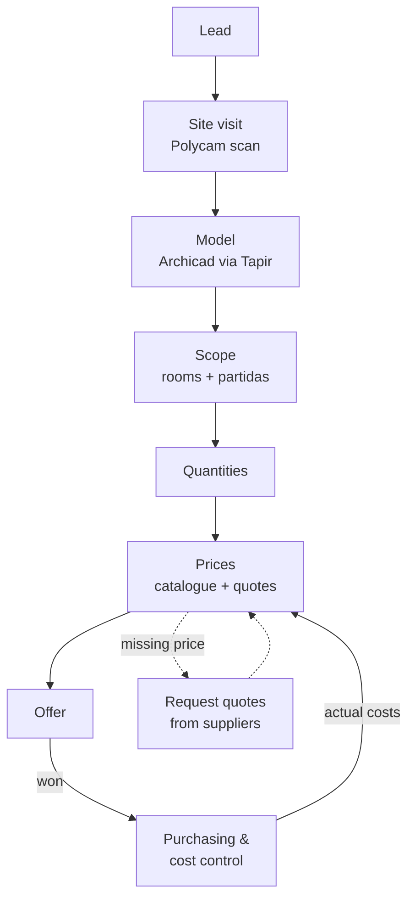
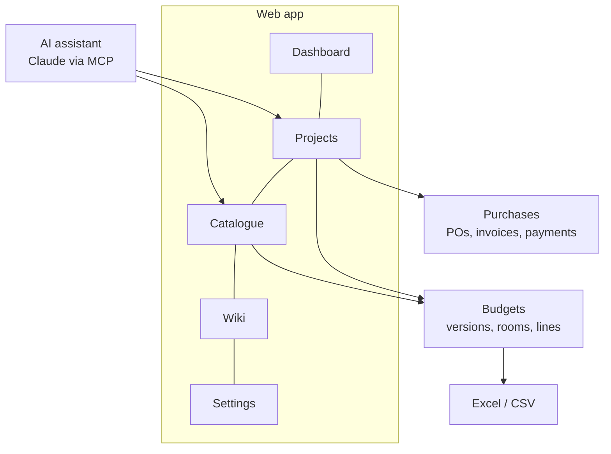

<!-- section: Start here -->
# Overview
> What the platform is for, the problem it solves and how the pieces fit.

Renovation Bids turns the **unpaid pre-contract work** on an interior renovation in Madrid (visit, measure, scope, price, offer) into a repeatable workflow. The goal is to get from site visit to a priced offer in about three days, without spending architect hours on what a standard catalogue can do.

## The idea in one paragraph

Every bid is built from the same **standard catalogue** of work items (*partidas*), each with a code, a unit and your studio's price. A room is a recipe of partidas scaled by its size (a 5 m² bathroom needs about 18.5 m² of wall tiling). Before the contract, a bid is **one generic standard option**. No variations or client wishes until the job is won. That keeps the bid fast and comparable. After the contract, the same budget becomes the baseline for purchasing and cost control, and what you actually pay feeds back into your prices.

## The workflow

| Step | In the platform today | Planned |
|---|---|---|
| Lead → project | Projects with status, client, area, budget | Lead scoring (go / no-go) |
| Site visit, scan | Tracked in the database | Polycam/RoomPlan scan → Tapir → Archicad |
| Scope | Rooms from templates + single partidas | Scope from the Archicad model |
| Quantities | Template formulas, manual edits, batch edit | Quantities read from Archicad zones and elements |
| Prices | Catalogue with history and confidence ranges | Supplier quotes parsed by AI, reviewed by you |
| Offer | Budget range, Excel export | Offer PDF, payment schedule, link to the Fee Calculator |
| After winning | Purchase orders, invoices, payments, cost by chapter | Supplier portal, delivery tracking |

## The parts of the platform

- **[Dashboard](/wiki/dashboard)**: what needs doing today, and how the business is going.
- **[Projects and budgets](/wiki/budgets)**: one project per job. Each has budget versions made of lines.
- **[Catalogue](/wiki/catalogue)**: the partidas and your prices.
- **[Purchases](/wiki/purchases)**: after the contract, what you order, receive and pay.
- **[AI assistant](/wiki/ai-assistant)**: do any of the above by talking to Claude.
- **[Settings](/wiki/settings-and-roles)**: studio, team, roles, AI rules, activity log.

## Principles

1. **One standard option until the contract.** Speed and comparability beat customisation at bid stage.
2. **Prices are evidence, not guesses.** Every price has a source, a date and a confidence, and confidence sets the range you quote.
3. **Everything is undoable.** Every change is logged with who made it and can be reverted.
4. **Your data is yours.** Each studio only ever sees its own projects, prices and suppliers. The standard catalogue is shared, your prices never are.
