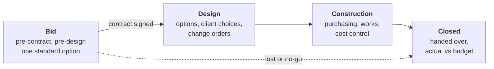
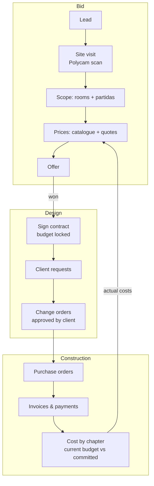

<!-- section: Start here -->
# Overview
> What the platform is for, how a project moves through its life, and how the pieces fit.

The platform manages an interior renovation **through its whole life**: from the first call, through the unpaid pre-contract bid, to design, construction and handover. One project, one budget history, one place for costs.

## The four phases

| Phase | Goal | Budget | Main tools |
|---|---|---|---|
| **Bid** | Win the job fast, without spending unpaid design hours | One standard version, priced from the catalogue as a low–high range | Rooms and templates, catalogue, quick audit, export |
| **Design** | Turn the standard scope into the client's project | The signed **contract** is frozen; every change is a **change order** | Client requests, change orders, versions for options |
| **Construction** | Build it within budget | **Current budget** = contract + approved changes, against what's committed and paid | Purchases, invoices, payments, cost by chapter |
| **Closed** | Learn from it | Actual vs bid range | Actual costs become prices for the next bid |

## The idea in one paragraph

Every budget is built from the same **standard catalogue** of work items (*partidas*), each with a code, a unit and your studio's price. A room is a recipe of partidas scaled by its size (a 5 m² bathroom needs about 18.5 m² of wall tiling). In the **bid**, a project gets **one generic standard option**, fast and comparable. **Signing the contract** freezes that budget as the baseline. From then on, every client wish, design change or site surprise is priced as a **change order** against it, so you always know the current budget and why it moved. Purchasing then tracks committed and paid cost per chapter, and what you actually pay feeds back into your prices.

## The workflow end to end

| Step | In the platform today | Planned |
|---|---|---|
| Lead → bid | Projects, bid status, standard budget, ranges | Lead scoring (go / no-go) |
| Scan and model | Rooms from any source matched to templates; line sources; version comparison | Model sync with preview (Archicad via Tapir), design options both ways |
| Offer | Budget range, Excel export | Offer document (PDF, payment schedule) |
| Contract | **Sign contract**: locked baseline | — |
| Design | Client requests, **change orders**, versions for options | Design stages and deliverables, client selections (finishes), approvals |
| Construction | Purchase orders, invoices, payments, cost by chapter (with approved changes) | Progress certificates, client payment schedule, site reports, snag list |
| Close | Actual costs → prices, estimate accuracy | Close-out report |

## The parts of the platform

- **[Dashboard](/wiki/dashboard)**: what needs doing today and how the pipeline and active jobs are going.
- **[Projects and the lifecycle](/wiki/project-lifecycle)**: phases, statuses, the bid rule.
- **[Budgets](/wiki/budgets)**: versions made of lines, rooms and templates.
- **[Rooms, templates and models](/wiki/rooms-and-models)**: from rooms (any source) to lines, and comparing versions.
- **[Contract and change orders](/wiki/contract-and-change-orders)**: the baseline, and every change after it.
- **[Catalogue](/wiki/catalogue)**: the partidas and your prices.
- **[Purchases](/wiki/purchases)**: what you order, receive and pay.
- **[AI assistant](/wiki/ai-assistant)**: do any of the above by talking to Claude.
- **[Settings](/wiki/settings-and-roles)**: studio, team, roles, AI rules, activity log.

## Principles

1. **One standard option in the bid; options after the contract.** Speed in the bid, the client's project after signing. A studio setting allows exceptions.
2. **Any source, one budget.** Rooms and quantities can come from Archicad, other software, drawings, AI assumptions or by hand. Every line remembers where it came from, and your edits win over syncs.
3. **The contract is the baseline.** It never changes. Changes are explicit, priced and approved.
4. **Prices are evidence, not guesses.** Every price has a source, a date and a confidence, and confidence sets the range you quote.
5. **Everything is undoable.** Every change is logged with who made it and can be reverted.
6. **Your data is yours.** Each studio only sees its own projects, prices and suppliers. The standard catalogue is shared, your prices never are.
