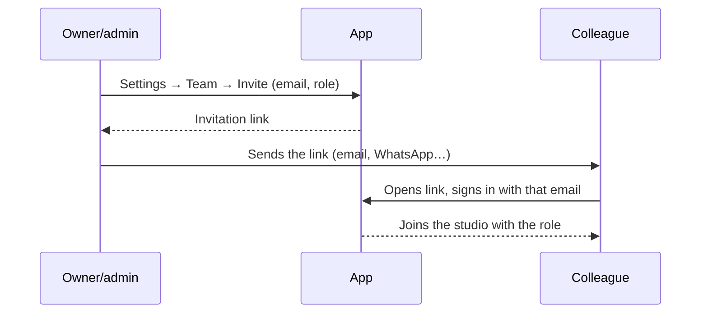

<!-- section: Start here -->
# Getting started
> Signing in, your studio, inviting the team, and a first bid in ten minutes.

## Signing in

Three ways, all landing in the same account (matched by email):

| Method | When to use it |
|---|---|
| **Continue with Google** | Quickest. Only weareenzyme.com Google accounts can use it (the Google app is set to *Internal*). |
| **Email + password** | Set a password in *Settings → Profile*. "Forgot password?" emails a link to set a new one. |
| **Email me a link** | Fallback. Limited to a few emails per hour by the mail service. |

The app keeps you signed in on each browser until you sign out.

## Your studio

The first person to sign in creates the **studio** (ENZYME APD) and becomes its **owner**. Colleagues with a company email join in one of two ways:

- **By domain** (simplest): an admin sets the company email domain in *Settings → Studio* (for us, *weareenzyme.com*). Anyone who signs in with a verified email on that domain sees **Join ENZYME APD** and joins as a *member*; an admin can change the role later.
- **By invitation**, for anyone else (a freelancer, a consultant with another domain):

The link only works for the email it was made for, and only once. See [Settings and roles](/wiki/settings-and-roles) for what each role can do.

## A first bid in ten minutes

**Example: a 70 m² flat in Chamberí, kitchen and one bathroom.**

1. **Projects → + New project.** Name "Piso Chamberí 3º B", client, district, area 70 m², the client's budget if they gave one. The project opens with version **A** ready.
2. Open version A. **+ Add room → Partidas generales de la vivienda**, size 70: once-per-job items (preliminaries and protections, electrical panel, builder's help, waste, health & safety, final cleaning).
3. **+ Add room → Demolición de baño o cocina existente** for each wet room you strip out, then **Cocina**, 9 m², and **Baño completo con ducha**, 5 m². Kitchen units go as a separate line (COC-010, per linear metre).
4. Switch to **By room** to read it as the client would, or **By chapter** to read it as a contractor would.
5. Click **Incomplete only** and price what's missing (or mark it *needs quote*).
6. The low–high range at the top is your bid range before VAT (see [Pricing and ranges](/wiki/pricing-and-ranges)). **Export → Excel** if you want to send it on.

## After you win

7. Set the bid status to **won**, then **Sign contract…** on the project page: the budget is locked as the baseline and the project moves to **Design**.
8. Record what the client asks for under **Client requests**, then **Price as change order** for each one. Send it, and record the approval.
9. When works start, move the phase to **Construction** and use **Purchases and cost control**.

Next: [the project lifecycle](/wiki/project-lifecycle) in detail.
