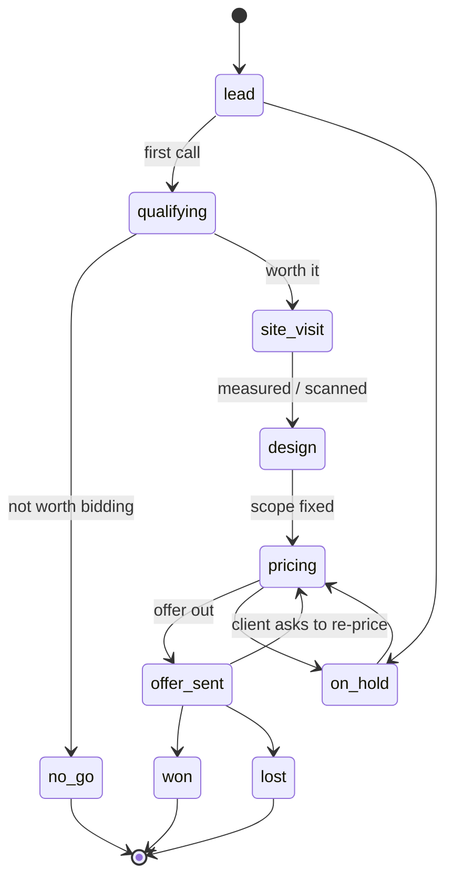
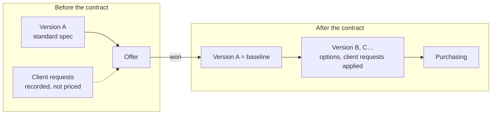

<!-- section: Start here -->
# The bid workflow
> From first call to signed contract: statuses, the one-option rule, and what happens at each step.

## Project statuses

A project moves through these statuses. You set them on the project page (or ask the AI assistant).

| Status | Meaning | Typical next step |
|---|---|---|
| lead | A contact, nothing checked yet | Call, ask budget, address, timing |
| qualifying | Deciding whether to bid | Go / no-go |
| no_go | Decided not to bid | Note the reason |
| site_visit | Visit booked or done | Scan, photos, laser checks |
| design | Scope being defined | Rooms and partidas |
| pricing | Budget being priced | Fill the gaps, request quotes |
| offer_sent | Offer with the client | Follow up before it expires |
| won / lost | Outcome | Won: purchasing starts. Lost: note why |
| on_hold | Paused by the client or you | — |

## The bid-stage rule: one standard option

> Until a project is **won**, it has **one version**: the studio's standard spec, priced quickly. The database refuses a second version before that.

Why: bids are unpaid. Options and client wishes multiply the work and make bids hard to compare. A standard spec gives a fast, defensible number, and the conversation about options happens once the client has committed.

What to do with client requests during the bid: record them as **client requests** on the project (*"wants a bathtub instead of a shower"*). They stay *open* and become the first job after signing.

## Step by step, with an example

**Calle Santa Hortensia 45 (PRJ-0001), 80 000 € client budget.**

1. **Lead → qualifying.** Create the project with the client's stated budget. A budget far below your €/m² benchmark (see the dashboard) is a no-go signal.
2. **Site visit.** Scan with Polycam (LiDAR) and take photos. Today the scan is used to model by hand in Archicad. The planned Tapir link will read rooms and areas straight from the model.
3. **Scope.** Add rooms from templates: the bathroom (23 lines from a 7.5 m² *Baño completo con ducha*), kitchen, living room. Add single partidas for anything special.
4. **Quantities.** Templates set them from the room size. Check the ones that matter most (tiling, flooring) against the model.
5. **Prices.** Most lines price themselves from the catalogue. **Incomplete only** shows the gaps. Price them, or mark *needs quote* and ask a supplier.
6. **Offer.** The range at the top of the budget (low–high) is what you quote, before VAT. Export to Excel for the offer document.
7. **Won.** Set the status to *won*. Now you can add versions for options, and purchasing opens.
