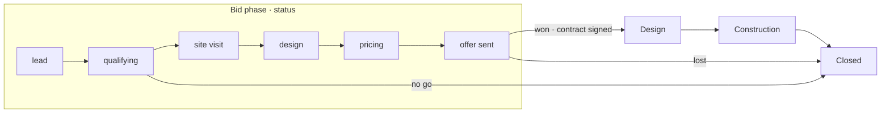

<!-- section: Start here -->
# Project lifecycle
> The four phases, the bid statuses, the one-option rule, and what happens at each step.

## Phases and statuses

A project has a **phase** (where it is in its life) and, during the bid, a **status** (where the bid stands). Both are on the project page.

- **Winning** (status *won*, or signing the contract) moves a bid to **Design** on its own. **Lost** and **no go** move it to **Closed**.
- Other moves are yours: click the phase on the project page when works start on site (**Construction**) and when it's handed over (**Closed**).

| Bid status | Meaning | Typical next step |
|---|---|---|
| lead | A contact, nothing checked yet | Call, ask budget, address, timing |
| qualifying | Deciding whether to bid | Go / no-go |
| no go | Decided not to bid | Note the reason |
| site visit | Visit booked or done | Scan, photos, laser checks |
| design | Pre-contract sketch of the scope | Rooms and partidas |
| pricing | Budget being priced | Fill the gaps, request quotes |
| offer sent | Offer with the client | Follow up before it expires |
| won / lost | Outcome | Won: sign the contract. Lost: note why |
| on hold | Paused | — |

> The *design* bid status is the quick pre-contract sketch needed to price. The **Design phase** is the real design work after the contract.

## Phase 1 · Bid (pre-contract, pre-design)

> Until a project is **won**, it has **one version**: the studio's standard spec, priced quickly. The database refuses a second version before that.

Why: bids are unpaid. Options and client wishes multiply the work and make bids hard to compare. A standard spec gives a fast, defensible number, and options are discussed once the client has committed.

Reality sometimes asks otherwise. An owner or admin can switch on **Allow options during the bid** in *Settings → Studio*; it is off by default.

Client wishes during the bid are recorded as **client requests** (*"wants a bathtub instead of a shower"*). They stay *open* and get priced as change orders after signing.

**Example: Calle Santa Hortensia 45 (PRJ-0001), 80 000 € client budget.**
1. **Lead → qualifying.** Create the project with the client's budget. A budget far below your usual €/m² (dashboard) is a no-go signal.
2. **Site visit.** Scan with Polycam and take photos.
3. **Scope.** Rooms from templates (a 7.5 m² *Baño completo con ducha* adds 23 lines), plus single partidas. Rooms can come from a quick Archicad model, a drawing, or Claude's assumptions: see [Rooms, templates and models](/wiki/rooms-and-models).
4. **Prices.** Most lines price themselves. **Incomplete only** shows the gaps.
5. **Offer.** The low–high range is what you quote, before VAT.

## Phase 2 · Design (after the contract)

1. **Sign the contract** on the project page: choose the version signed, the agreed value and the date. A locked **Contract** version is created: the baseline. See [Contract and change orders](/wiki/contract-and-change-orders).
2. Work through the **client requests**: price each as a **change order**, send it, record the client's decision.
3. Use extra **versions** to explore options (B: bathtub, C: open kitchen), linked to Archicad design options if you use them, and **compare** them on the project page before turning the chosen one into a change order.

## Phase 3 · Construction

**Purchases and cost control** tracks purchase orders, supplier invoices and payments against the **current budget** (contract + approved changes) per chapter. Changes found on site (*site condition*) are change orders too. See [Purchases](/wiki/purchases).

## Phase 4 · Closed

Handed over (or lost). Delivered costs saved as prices make your next bid more accurate, and the database compares actual cost with the bid range (see [Pricing and ranges](/wiki/pricing-and-ranges)).
