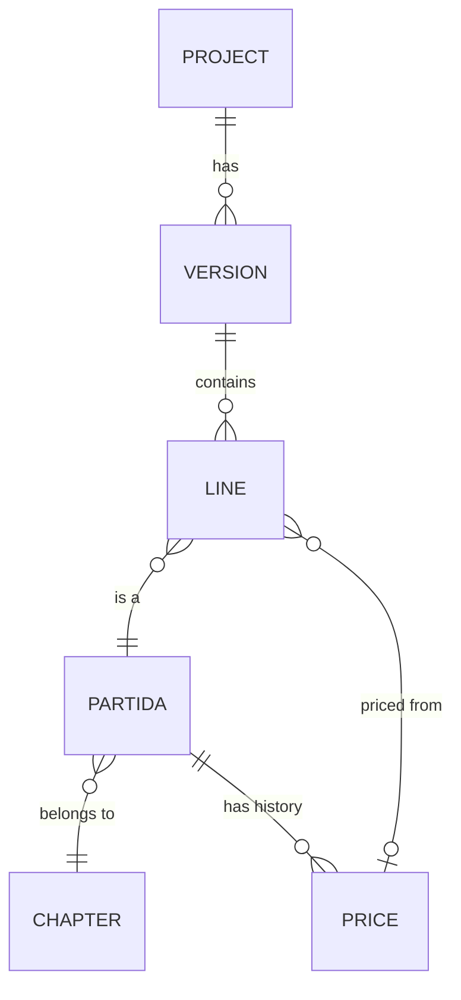

<!-- section: Working with the platform -->
# Budgets
> Versions, lines, rooms and templates; grouping, batch editing and the quick audit.

## How a budget is built

- A **version** (A, B…) is one complete budget. Before the contract there is only A, unless the studio allows options in the bid (see [the project lifecycle](/wiki/project-lifecycle)). The project page compares versions side by side. When the contract is signed, a locked **Contract** version is added: the baseline (see [Contract and change orders](/wiki/contract-and-change-orders)).
- A **line** is one partida with a quantity, a unit price, a confidence, a state and optionally a **room**.
- **Line total = quantity × unit price.** The budget range comes from each line's confidence (see [Pricing and ranges](/wiki/pricing-and-ranges)).

## Rooms and templates

A **room** has a floor area, a perimeter and a height. A **room template** is a recipe: for each partida,
**quantity = a × floor area + b × perimeter + c × wall area + fixed**, where **wall area = perimeter × height − doors and windows**.

**Example: *Baño completo con ducha*, 5 m² of floor, 2.2 × 2.3 m (perimeter 9 m), 2.5 m high, one door (1.6 m²)**

| Partida | Rule | Quantity | Price | Total |
|---|---|---|---|---|
| IMP-010 Impermeabilización de suelo en zona húmeda | 1 × floor | 5 m² | — | needs a price |
| PAV-020 Solado de gres porcelánico | 1 × floor | 5 m² | 86 € | 430 € |
| REV-010 Alicatado de gres porcelánico | 1 × wall area | 9 × 2.5 − 1.6 = 20.9 m² | 90 € | 1 881 € |
| TEC-020 Falso techo continuo PYL hidrófugo | 1 × floor | 5 m² | 32 € | 160 € |
| SAN-010 Plato de ducha | fixed 1 | 1 ud | 640 € | 640 € |
| FON-010 Punto de agua fría y caliente | fixed 4.5 | 4.5 ud | … | … |

**Without a perimeter**, the room is taken as a 1:1.5 rectangle (5 m² → 9.13 m) and the perimeter is marked *estimated*. **Without a height**, the project's height is used, else the studio's (Settings → Studio, 2.60 m by default), marked *default*. Measure later with **Edit room** in the *By room* view: the room's lines are recalculated, except those you edited by hand.

There are ten standard templates: whole-flat general items, bedroom, living room, hall, full bathroom, toilet, kitchen, laundry, window replacement (per window) and stripping out an existing bathroom or kitchen. Adapt them, or add your own, in **Catalogue → Room templates** (see [Rooms, templates and models](/wiki/rooms-and-models)).

Lines added by a template are tagged with the room name (*Baño principal*). Add the same template twice with different names for two bathrooms.

Each line also shows where it came from (*from template*, *from model zone*, *AI assumption*…), and **edited** once you change its quantity by hand: model syncs leave edited lines alone.

## Reading a budget: by chapter or by room

| View | Good for |
|---|---|
| **By chapter** | Contractors, quotes, purchasing: everything tiled together, in site order (demolition first, cleaning last) |
| **By room** | The client, design decisions: what the bathroom costs |

Each group can be collapsed, and **Collapse all** gives a one-screen summary with subtotals.

## Editing many lines at once

Tick lines (or a whole group, or everything) and a bar appears:

| Action | Example |
|---|---|
| Set state | Mark 6 electrical lines *needs quote* |
| Set confidence | Raise tiling to *high* after a supplier confirms |
| Move to room | Put loose lines into *Cocina* |
| Set unit price | Same price for three paint lines |
| Multiply quantity | ×1.1 to add 10% waste to all tiling |
| Delete | Remove a room you added by mistake |

Every batch is **one change**: the bar offers **Undo** straight away, and *Settings → Activity* keeps it for later.

## The quick audit

**Incomplete only** shows only lines that need attention, each with a label:

| Label | Means |
|---|---|
| no price | No unit price yet |
| no quantity | Quantity is 0 |
| no confidence | Priced, but without saying how sure you are |
| needs quote | Waiting for a supplier |
| no room | The budget uses rooms but this line has none |

The dashboard's *"N lines without a price"* opens the budget straight in this view.

## Line details

**Details** on a line opens what doesn't fit in the row:

| Field | Printed in the offer | Use |
|---|---|---|
| **Supplied by** | ✓ | *Contractor* lines make the works contract. *Client buys it* lines (kitchen units, appliances) are listed apart and never added to the contract total |
| **Description in the offer** | ✓ | Job-specific text. Empty = the catalogue's description |
| **Note for the client** | ✓ | "Medición a confirmar en obra", "Precio a confirmar por instalador" |
| **How it was measured** | ✓ | "13,44 ml × 2,50 m" |
| **Internal note** | ✗ | For the team only |
| **Reference price** | ✗ | A price the client found elsewhere (another contractor, a web price). The row shows how far yours is from it |
| **Measurement lines** | ✓ (measurements sheet) | Nº × length × width × height per place. With measurement lines, the quantity is their sum; a negative Nº deducts (a door opening) |

## Import and export: a round trip

**Export** gives Excel, CSV or JSON. The Excel has a **Lines** sheet (with an ID per line), a **Measurements** sheet and the chapter summary. Edit it anywhere (Excel, Google Sheets, a script) and bring it back with **Import**:

- rows with an ID update that line (only the columns present);
- rows without an ID add lines; a code not in the catalogue becomes a studio partida (give it Title, Unit and a Chapter code);
- tick *Delete lines not in the file* to make the version match the file exactly;
- the import shows a preview first (lines, new codes, totals per chapter) and applies all or nothing, as one change you can undo.

Import also reads a studio **PRESUPUESTO / MEDICIONES** workbook (Código, Título, Descripción, Cant., Precio, Imp. Constructora, Imp. Propiedad, Notas, Medición), including quantities that are formulas pointing at the measurements sheet. Its chapters are mapped to catalogue chapters, room sub-chapters (Dormitorio, Baño…) become rooms, *LO COMPRA LA PROPIEDAD* becomes *client buys it*, and the preview compares each of its chapter totals with what will be imported.

**Example:** Santa Hortensia 45 (P26021), 132 lines from his workbook, imports at exactly **97,064.58 €**, the total of the PDF sent to the client.

## Exporting only

**Export → Excel** gives two sheets: every line (chapter, code, description, room, unit, quantity, price, total, confidence, state) and the chapter summary with low and high. **CSV** gives the lines as plain data. To use Google Sheets, upload the Excel file to Drive and open it there.
