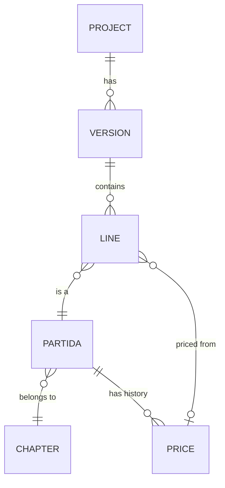

<!-- section: Working with the platform -->
# Budgets
> Versions, lines, rooms and templates; grouping, batch editing and the quick audit.

## How a budget is built

- A **version** (A, B…) is one complete budget. Before the contract there is only A (see [the bid workflow](/wiki/bid-workflow)).
- A **line** is one partida with a quantity, a unit price, a confidence, a state and optionally a **room**.
- **Line total = quantity × unit price.** The budget range comes from each line's confidence (see [Pricing and ranges](/wiki/pricing-and-ranges)).

## Rooms and templates

A **room template** is a recipe: for each partida, **quantity = factor × size + fixed**.

**Example: *Baño completo con ducha*, 5 m² of floor**

| Partida | Rule | Quantity | Price | Total |
|---|---|---|---|---|
| IMP-010 Impermeabilización de suelo en zona húmeda | 1.0 × size | 5 m² | — | needs a price |
| PAV-020 Solado de gres porcelánico | 1.0 × size | 5 m² | 86 € | 430 € |
| REV-010 Alicatado de gres porcelánico | **3.7** × size | 18.5 m² | 90 € | 1 665 € |
| TEC-020 Falso techo continuo PYL hidrófugo | 1.0 × size | 5 m² | 32 € | 160 € |
| SAN-010 Plato de ducha | fixed 1 | 1 ud | 640 € | 640 € |
| FON-010 Punto de agua fría y caliente | fixed 4.5 | 4.5 ud | … | … |

The factor 3.7 comes from Ortega y Gasset 47: 38.9 m² of tiling for 10.5 m² of wet-room floor. Factors are where your experience lives. Refine them as you measure more jobs.

There are ten templates: whole-flat general items, bedroom, living room, hall, full bathroom, toilet, kitchen, laundry, window replacement (per window) and stripping out an existing bathroom or kitchen.

Lines added by a template are tagged with the room name (*Baño principal*). Add the same template twice with different names for two bathrooms.

## Reading a budget: by chapter or by room

| View | Good for |
|---|---|
| **By chapter** | Contractors, quotes, purchasing: everything tiled together, in site order (demolition first, cleaning last) |
| **By room** | The client, design decisions: what the bathroom costs |

Each group can be collapsed, and **Collapse all** gives a one-screen summary with subtotals.

## Editing many lines at once

Tick lines (or a whole group, or everything) and a bar appears:

| Action | Example |
|---|---|
| Set state | Mark 6 electrical lines *needs quote* |
| Set confidence | Raise tiling to *high* after a supplier confirms |
| Move to room | Put loose lines into *Cocina* |
| Set unit price | Same price for three paint lines |
| Multiply quantity | ×1.1 to add 10% waste to all tiling |
| Delete | Remove a room you added by mistake |

Every batch is **one change**: the bar offers **Undo** straight away, and *Settings → Activity* keeps it for later.

## The quick audit

**Incomplete only** shows only lines that need attention, each with a label:

| Label | Means |
|---|---|
| no price | No unit price yet |
| no quantity | Quantity is 0 |
| no confidence | Priced, but without saying how sure you are |
| needs quote | Waiting for a supplier |
| no room | The budget uses rooms but this line has none |

The dashboard's *"N lines without a price"* opens the budget straight in this view.

## Exporting

**Export → Excel** gives two sheets: every line (chapter, code, description, room, unit, quantity, price, total, confidence, state) and the chapter summary with low and high. **CSV** gives the lines as plain data. To use Google Sheets, upload the Excel file to Drive and open it there.
