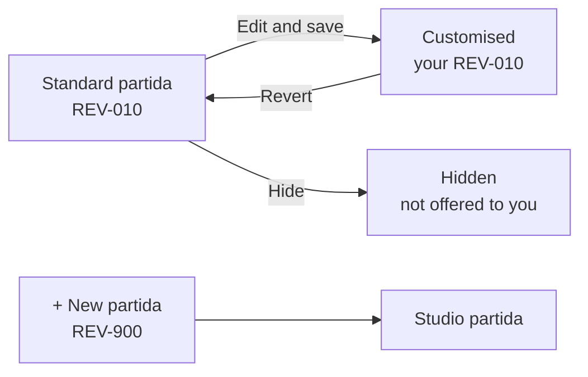

<!-- section: Working with the platform -->
# Catalogue
> Partidas, codes and chapters; standard vs studio partidas; hiding; prices and their history.

## What a partida is

A **partida** is one priced unit of work, **all-in** (supply and fit) at the studio's standard spec:

> **REV-010 · Alicatado de gres porcelánico · m²**. Porcelain wall tiling, including material, cementitious adhesive, grouting and cleaning.

| Field | Example | Notes |
|---|---|---|
| Code | REV-010 | Chapter prefix + number in steps of 10, so new items fit in between |
| Description | Alicatado de gres porcelánico | Short, plus a full description of what's included |
| Unit | m² | m², m, m³, ud, kg, h or PA (lump sum) |
| Chapter | REV · Revestimientos de paredes | One of 20, in site order |
| Reference | (optional) | e.g. the matching CYPE *Generador de Precios* code |

**A code never changes meaning.** If the spec changes (large-format tile instead of standard), make a new code (REV-020), so past budgets stay true.

## The 20 chapters

Chapters follow the order of the works on site, and map to the chapter letters of the CYPE *Generador de Precios – Rehabilitación*:

| # | Code | Chapter | # | Code | Chapter |
|---|---|---|---|---|---|
| 1 | PRE | Actuaciones previas y medios auxiliares | 11 | SAN | Sanitarios, grifería y equipamiento de baño |
| 2 | DEM | Demoliciones y desmontajes | 12 | COC | Cocina |
| 3 | TAB | Tabiquería y trasdosados | 13 | ELE | Electricidad y telecomunicaciones |
| 4 | TEC | Falsos techos y molduras | 14 | ILU | Iluminación |
| 5 | IMP | Aislamientos e impermeabilizaciones | 15 | CLI | Climatización, calefacción y ventilación |
| 6 | REV | Revestimientos de paredes | 16 | PIN | Pintura |
| 7 | PAV | Pavimentos y rodapiés | 17 | AYU | Remates y ayudas |
| 8 | CEX | Carpintería exterior y protecciones solares | 18 | RES | Gestión de residuos |
| 9 | CIN | Carpintería interior y mobiliario a medida | 19 | SYS | Seguridad y salud |
| 10 | FON | Fontanería y saneamiento | 20 | LIM | Limpieza y entrega |

## Standard, customised and studio partidas

The **standard catalogue** (97 partidas for Spain) is shared by every studio on the platform and is read-only. Your studio adapts it without touching it:

| Badge | What it is | You can |
|---|---|---|
| **Standard** | The shared item | Price it, Edit (makes it customised), Hide |
| **Customised** | Your studio's version of a standard code: same code, your wording or spec | Price, Edit, Hide, Revert (back to standard) |
| **Studio** | A code only your studio has | Price, Edit, Hide, Delete (if unused) |
| **Hidden** | You chose not to use it | Show it again |

Your version **replaces** the standard one everywhere in your studio: the add-line picker, room templates and the AI assistant. Other studios keep the standard.

**Example.** You always tile with large-format 60×120 porcelain. Edit **REV-010** and change the description to *"Alicatado porcelánico gran formato 60×120"*. Every new bathroom from a template now uses your version and your price.

**Delete or hide?** A partida used in any budget or purchase line can't be deleted, so past budgets stay intact. Hide it instead.

## Prices

Each partida can have many prices over time: its **history**. Click **Price** to add one or see them.

| Field | Values | Why it matters |
|---|---|---|
| Unit price | € per unit, before VAT | |
| Confidence | high, medium, low | Sets the range budgets show (see [Pricing and ranges](/wiki/pricing-and-ranges)) |
| Source | manual, past project, reference, quote | Where the number came from |
| Valid until | optional date | Expired prices stop being used |
| Note | free text | e.g. *"OG47 PCA 40 + PS 45"* |

**Which price is used?** The newest valid one, preferring your studio's own over shared ones, and higher confidence over lower. Prices from supplier quotes parsed by the AI only count once someone has reviewed the quote.

New budget lines take the price in use at that moment. Existing lines keep theirs until you change them, so a price change never silently moves a sent offer.

## Quality control

- **Unpriced only (n)** lists partidas with no price. Price them before they show up in a bid.
- **Export → Excel** gives the whole catalogue with current prices, to review offline or share with a contractor.
