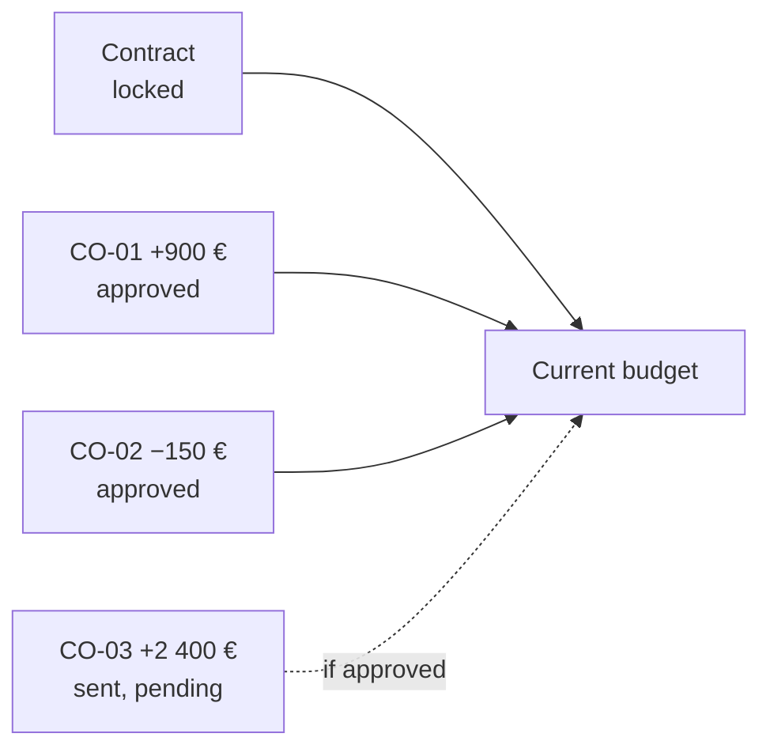
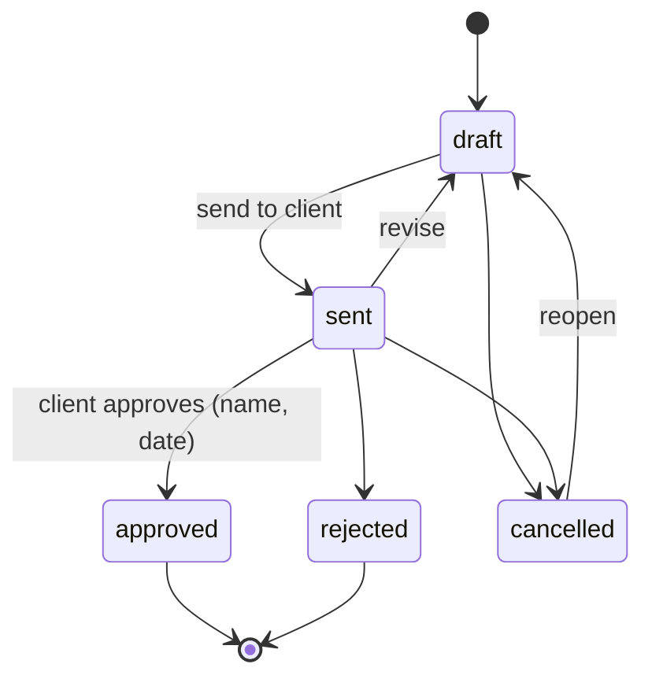
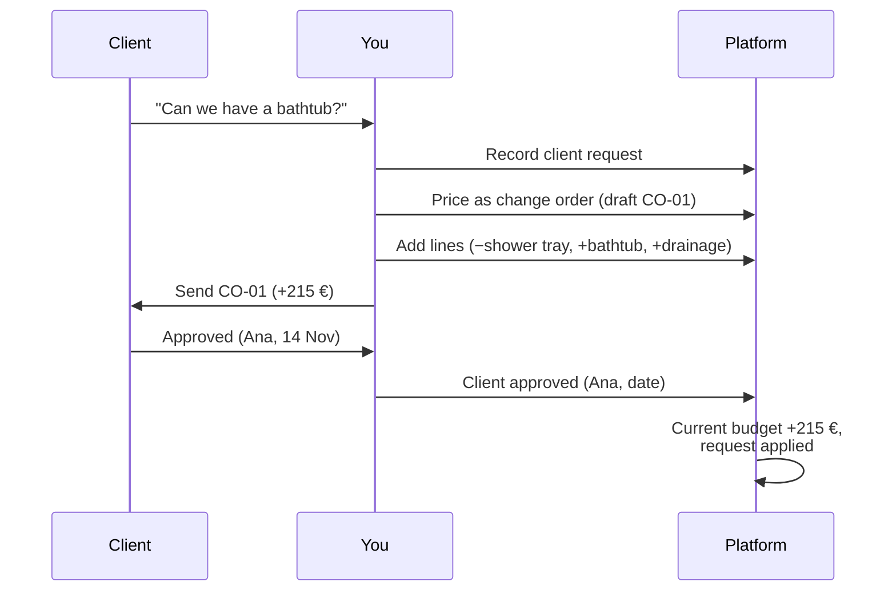

<!-- section: Working with the platform -->
# Contract and change orders
> The signed contract as a locked baseline, and how every change after it is priced, approved and tracked.

## Why a baseline

After signing, a renovation budget moves: the client changes their mind, the design develops, walls hide surprises. If the budget is simply edited, nobody can say later what was agreed, what changed and who approved it. So the platform **freezes the signed budget** and records every change on top of it.

**Current budget = contract + approved change orders.** Pending ones are shown apart, so you always see the exposure.

## Signing the contract

On a won project: **Sign contract…**, then choose:

| Field | Notes |
|---|---|
| Version signed | Usually A, the bid budget |
| Contract value | What was agreed, before VAT. Empty = the budget total |
| Signed on | The date of the contract |

The platform then:
1. copies that version as a new version **Contract**, with all its lines;
2. **locks** it: nobody can edit, add or delete its lines (the database refuses);
3. records the value and date, marks the project **won** and moves it to the **Design** phase.

The original version stays editable for working on options. Made a mistake? Undo the signing in *Settings → Activity*.

## Change orders

A **change order** (CO-01, CO-02… per project) prices one change against the contract.

| Reason | Example |
|---|---|
| Client request | Bathtub instead of a shower |
| Design change | Hall in porcelain instead of laminate |
| Site condition | Rotten beam found behind the ceiling |
| Omission | Something missing from the contract budget |

Each line is **extra work** (positive quantity) or **work taken out** (negative quantity), from a catalogue partida (your current price is used) or a free line.

**Example: CO-01 · Bathtub instead of the shower**

| Work | Quantity | Unit price | Amount |
|---|---|---|---|
| SAN-010 Plato de ducha (taken out) | −1 ud | 640 € | −640 € |
| Bañera acrílica 170×75, supply and fit | +1 ud | 780 € | +780 € |
| Drainage alteration for the bathtub (free line) | +1 ud | 75 € | +75 € |
| **Total** | | | **+215 €** |

### Statuses

- **Approved**: added to the current budget and to its chapter in cost control. Lines are frozen. If it came from a client request, the request is marked *applied*.
- **Rejected / cancelled**: no effect on the budget (a rejected client request is marked *dropped*).
- A change order **sent over a week ago** without an answer appears in the dashboard's action items.

## From client request to change order

## Where it shows

| Place | What you see |
|---|---|
| Project page | Contract, approved changes, pending changes, current budget, plus the list of change orders and client requests |
| Contract version | Read-only, with a 🔒 banner |
| Purchases and cost control | Chapter budgets include approved changes, and the top figure is the current budget |
| Dashboard | Change orders waiting for the client |
| AI assistant | *"Price the bathtub request on PRJ-0001 as a change order"* |
