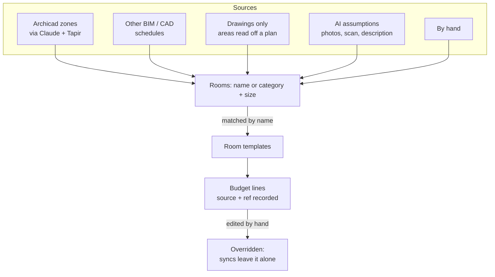

<!-- section: Working with the platform -->
# Rooms, templates and models
> From a list of rooms to a budget, wherever the rooms come from: Archicad, another tool, a drawing, an AI estimate or your own hand.

## One loop, any source

The budget does not care **where** the rooms and quantities come from. Each source feeds the same path: rooms are matched to **templates**, templates turn sizes into **lines**, and every line remembers its **source**.

| Source | Typical moment | How it reaches the budget |
|---|---|---|
| **Archicad** | Bid (quick model from a scan) and design | Claude reads zones through Tapir (area, perimeter, height, openings) and adds rooms with *source: model zone* and the zone id |
| **Other BIM / CAD** | Any | Export a zone or room schedule; Claude adds the rooms with *source: import* |
| **Drawings only** | Bid on an existing flat | Claude reads a dimensioned sketch or plan and works out each room's area, perimeter and openings |
| **AI assumptions** | First call, before a visit | Claude estimates rooms from photos or a description, marked *AI assumption* so nobody mistakes them for measured |
| **By hand** | Any | **+ Add room** in the budget |

## Room geometry

Every room has three measurements, and each partida scales with the one that drives it:

| Measurement | Drives | Where it comes from |
|---|---|---|
| **Floor area** | flooring, ceilings, waterproofing | zone area, plan, laser |
| **Perimeter** | skirting, cornices | zone perimeter, plan dimensions |
| **Height** | with the perimeter, the **wall area** (paint, tiling) | zone height, section, laser; else project or studio default |
| Doors and windows | deducted from the wall area | openings in the zone's walls, plan |

| Source | Area | Perimeter | Height |
|---|---|---|---|
| Archicad zone | ✓ | ✓ | ✓ |
| Dimensioned plan sketch (photo or PDF) | Claude works it out | Claude works it out | if noted on the sketch, else default |
| Site measurements | ✓ | ✓ | ✓ |
| Area only | ✓ | *estimated* (1:1.5 rectangle) | *default* |

Estimated and default values are labelled in the room header, so a budget built from guesses never looks measured.

**Why not a ratio to the floor?** The old templates used, for example, 0.9 m of skirting per m² of floor (the Ortega y Gasset 47 average). A 10 m² bedroom has about 12.9 m of perimeter, so the ratio fell 30 % short. Small rooms and tall ceilings were always wrong.

## Room templates

**Catalogue → Room templates** lists the recipes. For each partida: **quantity = a × floor area + b × perimeter + c × wall area + fixed**.

- **Edit** a standard template to make your studio's version (same code). Your budgets use yours from then on; *Reset to standard* brings the original back.
- **+ New template** for rooms you cost often that have no standard (terrace, dressing room, home office).
- **Hide** a template you never use.
- The **preview** shows what a room of any size costs at your current prices, and its cost per m².

### Matching rooms to templates

Each template has a list of **room names / zone categories** it matches (case-insensitive). An exact name wins; otherwise the longest name contained in the room's name.

| Room or zone | Matches | Why |
|---|---|---|
| Baño 2 | Baño completo con ducha | contains *baño* |
| ASEO | Aseo | exact, ignoring case |
| Salón-comedor | Salón-comedor | exact beats *salón* and *comedor* |
| Trastero | — | no template: added by hand or a new template |

Use the same terms as your Archicad **zone categories** and the matching is automatic.

## Where each line came from

Every line records its **source** (shown next to its code in the budget):

| Source | Means |
|---|---|
| *(none shown)* | Added by hand |
| from template | A room added from a template |
| from model zone | A room from a model zone (Archicad or other), keyed by the zone id |
| from model | A quantity taken from model elements, keyed by the element id |
| AI assumption | Claude's estimate, to confirm later |
| imported | From a schedule, spreadsheet or drawing |

When you change the **quantity or the partida** of a generated line, it is marked **edited**. A later sync from the model updates generated lines but **never touches edited ones**, so your judgement is never overwritten. Price changes do not count as edits: prices come from the catalogue, quantities from the source.

## Versions and design options

A version can say **where it lives**: Archicad, Revit, SketchUp, other BIM, drawings only, AI assumptions or no model, plus the design option or file name (*"Archicad design option: Open kitchen"*). Set it when adding a version, under *Where this option lives*.

**Before the contract**: one standard version, as a rule. If a project really needs options in the bid, an owner or admin can switch on **Allow options during the bid** in *Settings → Studio*. It is off by default.

## Comparing versions

The project page shows **Compare versions** (or *Where the money goes* when there is only one):

- a **donut per version**, by chapter or by room, with the same colour for the same chapter in every donut;
- the difference against the first version picked, in euros and %;
- a **table by chapter or room** with the difference;
- **quantities by partida**, with *Only what changes* to see exactly what an option adds or removes.

**Example: PRJ-0001, A (bid) vs B (bathtub, open kitchen)**

| | A | B | B − A |
|---|---|---|---|
| Fontanería | 6 200 € | 6 900 € | +700 € |
| Albañilería | 4 300 € | 5 650 € | +1 350 € (wall taken down) |
| SAN-010 Plato de ducha | 1 ud | 0 ud | −640 € |

## Coming next

- **Sync from the model with a preview**: Claude reads zones and classified elements, shows what would be added, changed and removed, and applies it only after you approve. Edited lines are left alone.
- **Design options both ways**: create the option in Archicad and the version here, or the other way round.
- **Process and admin lines** suggested on each new budget: per job, per week on site, % of budget, per m².
- **Checks against Archicad schedules**, and a re-run of Ortega y Gasset 47 against the priced budget to measure accuracy.
