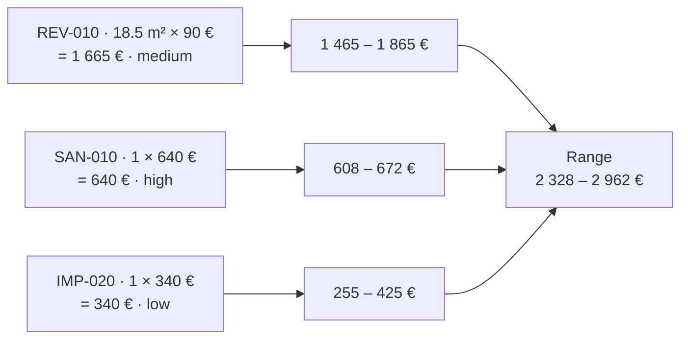
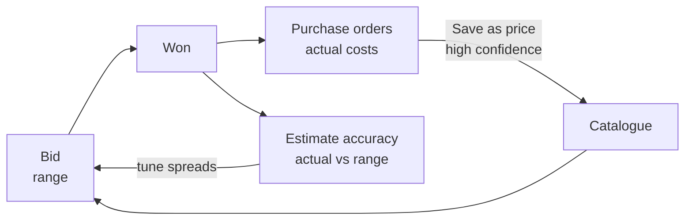

<!-- section: Methods -->
# Pricing and ranges
> Why a bid is a range, how the range is calculated, and how it gets narrower over time.

## Why a range

At bid stage the scope is standard and not all prices are firm. Quoting a single number hides that uncertainty, and a range is more honest. Each line contributes a spread that depends on **how sure you are of its price**.

## The rule

For each line: **low = total × (1 − spread)** and **high = total × (1 + spread)**. Spread depends on confidence:

| Confidence | Spread | Use it when |
|---|---|---|
| **high** | ±5% | A current supplier quote, or a price you paid recently |
| **medium** | ±12% | From a past project, adjusted with judgement |
| **low** | ±25% | A guess or a rough reference |
| *(none)* | ±25% | Treated as low |

The budget range is the sum of the line ranges.

**Worked example.** Three lines totalling 2 645 €:

| Line | Total | Confidence | Low | High |
|---|---|---|---|---|
| REV-010 tiling, 18.5 m² × 90 € | 1 665 € | medium (±12%) | 1 465.20 € | 1 864.80 € |
| SAN-010 shower tray | 640 € | high (±5%) | 608.00 € | 672.00 € |
| IMP-020 one item at 340 € | 340 € | low (±25%) | 255.00 € | 425.00 € |
| **Budget** | **2 645 €** | | **2 328.20 €** | **2 961.80 €** |

Get a firm quote for the 340 € item (high) and the range narrows from 2 328 – 2 962 € to 2 396 – 2 894 €.

The catalogue shows each price's own range under it, so you can see the effect before using it.

## Where the spreads come from

The spreads are a **starting assumption** for Spain, stored in the region settings. They are not measured yet. Measuring them is the point of the next section.

## Getting better with every job

1. **Actual costs become prices.** When a purchase line is delivered, **Save as price** stores what you really paid as a *high-confidence, past project* price.
2. **Accuracy is tracked.** For finished projects the database compares the actual cost with the bid range (*within range?* and *error vs the middle of the range*).
3. After a handful of jobs, set the spreads from that evidence. If 9 out of 10 jobs land within ±8% with medium prices, medium should be ±8%, not ±12%.

## VAT and contingency

Budgets are **before VAT**. Studio defaults (Settings → Studio): **VAT 10%** (the reduced rate for housing renovation in Spain, which applies only when the legal conditions are met, e.g. on materials share; otherwise 21%. Check each case with your gestor) and **contingency 7%**. They're stored now and will be applied by the offer step (planned); budget figures on screen don't include them.
