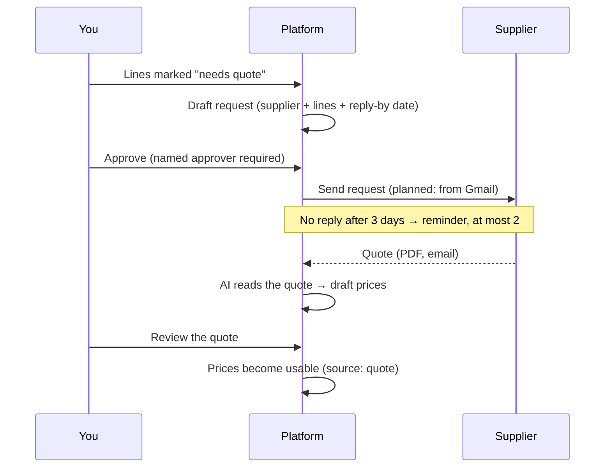
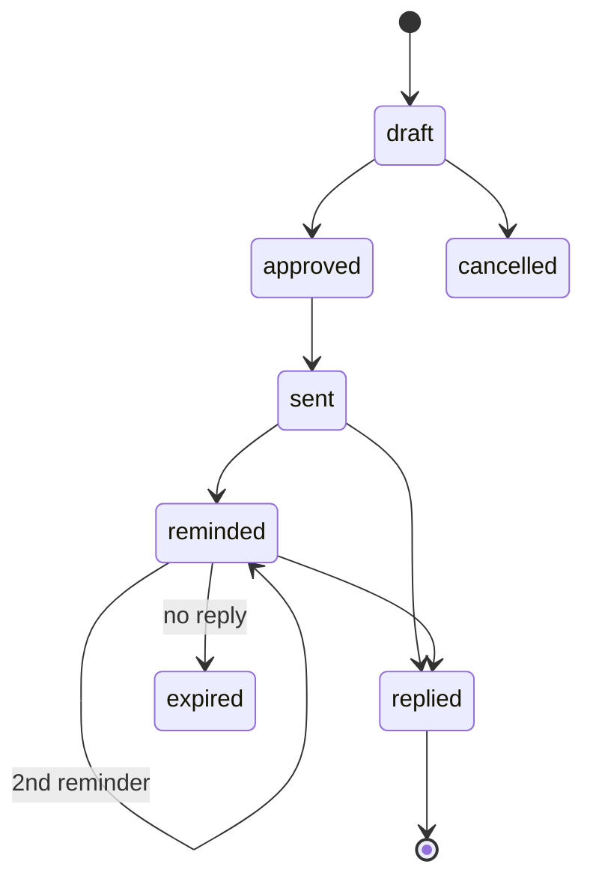

<!-- section: Methods -->
# Suppliers and quotes
> How missing prices get filled from suppliers: requests for quote, reminders, review.

When a line has no reliable price, mark it **needs quote** and ask suppliers. The database already models the whole loop. Screens for suppliers and quotes are still to come, so today you do this through the [AI assistant](/wiki/ai-assistant).

## The request-for-quote loop

| Rule | Why |
|---|---|
| A request can't be marked *sent* without a named approver | Nothing goes to a supplier without a person signing it off |
| Prices read by AI from a quote are not used until the quote is reviewed | An AI misread never reaches a bid |
| Unanswered requests expire after the last reminder (a daily job) | Action items stay clean |
| Suppliers found on the web must record where the contact came from | Spanish/EU data rules (GDPR, LSSI); opt-outs are respected |

## Request statuses

## Example, with the AI assistant

> *"For PRJ-0001, draft a request for quote to Fontanería López for all lines marked needs quote in the bathroom, reply by Friday."*

The assistant finds the lines, tells you exactly what it will create and waits for your OK. Then it creates a **draft** request. Approving and sending stay with you.

> *"López quoted 2 350 € for the bathroom plumbing, valid 30 days, excluding the shower screen. Record it."*

The quote is stored against the request. Once reviewed, the price is available for those lines.

## Supplier response stats

For each supplier the database tracks requests sent, answered, response rate and average days to reply. The AI assistant shows these when you list suppliers. Use them to decide who to ask first.
