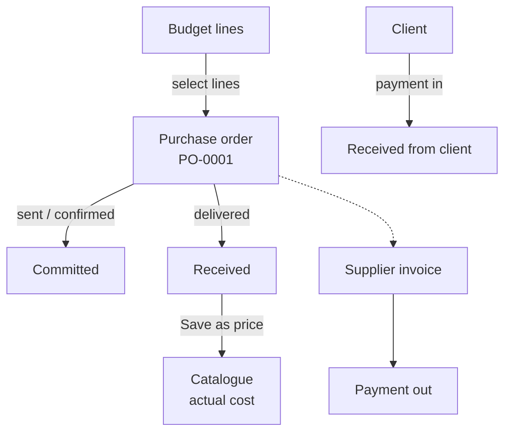

<!-- section: Working with the platform -->
# Purchases and cost control
> Construction phase: purchase orders, supplier invoices, payments, and cost by chapter against the current budget.

Open a project and click **Purchases and cost control**.

## The flow

## Purchase orders

A purchase order (numbered **PO-0001, PO-0002…** per studio) lists what you buy from one supplier. Its lines usually come from **budget lines**: tick them, and each line keeps its link to the budget with its quantity and your supplier unit cost. Free lines are allowed for anything not in the budget.

| Status | Meaning |
|---|---|
| draft | Being prepared |
| sent | Sent to the supplier (the order date is set) |
| confirmed | Supplier confirmed |
| delivered | Received on site. All lines count as received |
| cancelled | Not going ahead (stops counting as committed) |

**Bought by**: the studio, the contractor, or the client (for owner-supplied items), so you know whose cost it is.

## Cost by chapter

For each chapter: **budget** (the signed contract plus approved change orders in that chapter; before a contract, the main version), **committed** (purchase orders not cancelled) and **remaining**. A negative remaining shows in red: that chapter is over budget before you've finished buying.

**Example.** Tiling chapter (REV) budget 2 498 €. You order 18.5 m² at 82 € from the tile supplier (1 517 €) and 21 m² of fitting from the tiler at 45 € (945 €): committed 2 462 €, remaining 36 €.

## Invoices and payments

- **Supplier invoices**: amount before VAT, VAT, category (*labour, materials, extra*), due date, optionally linked to a purchase order. The page shows what's still outstanding per invoice.
- **Payments out** to suppliers (labour, materials, extra), optionally against an invoice.
- **Payments in** from the client: for the works or for your fees.

The money summary at the top: **current budget** (contract + approved changes), committed, invoiced, paid out, received from the client.

## Closing the loop

When a delivered purchase line is linked to a partida, **Save as price** records the real unit cost as a *high-confidence* price from a past project. Your next bid uses what you actually paid, not what you guessed (see [Pricing and ranges](/wiki/pricing-and-ranges)).
