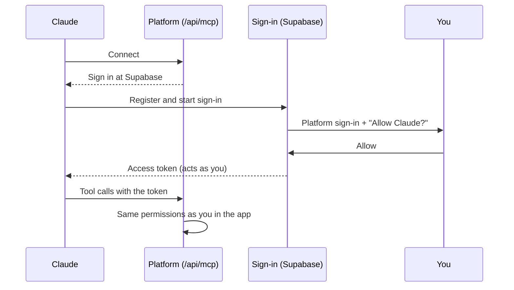

<!-- section: Working with the platform -->
# AI assistant
> Using the platform by talking to Claude: connecting, what it can do, rules, and example requests.

The platform exposes an **MCP server**, the standard way an AI assistant like Claude connects to an app. Once connected, Claude can read your projects, budgets and catalogue, and, if your role allows, make changes for you. It always tells you exactly what it will change and waits for your OK first.

## Connecting

1. In Claude: **Settings → Connectors → Add custom connector**.
2. Address: `https://renovation-bids.vercel.app/api/mcp`. The address is also shown under *Settings → AI access*.
3. Sign in with your studio account and click **Allow**.

The assistant acts **as you**: it sees exactly what you see and can change exactly what you can change.

## What it can do

| Read | Change (asks first) |
|---|---|
| Studio overview and action items | Create and update projects |
| Projects with phase, contract, change orders | Set the phase, sign the contract |
| Budgets with rooms, line by line | Add rooms from templates, add lines |
| Search the catalogue with your prices | Update or remove several lines at once |
| Room templates | Create versions (once a project is won) |
| Suppliers and their response rates | Record client requests |
| Cost control for won projects | Create change orders (with lines), send, approve, reject |
| | Create suppliers, draft requests for quote, record quotes |
| Recent changes (activity log) | Purchase orders, supplier invoices, payments |
| | **Undo** any change |

## Example requests

> *"What needs doing today?"*
> Overview plus action items, in priority order.

> *"New project: Piso Chamberí 3º B, client Marta Ruiz, 70 m², budget 60 000 €. Add the general items for the flat, a 9 m² kitchen and a 5 m² bathroom."*
> Creates the project, adds the three rooms and reports the lines and the range.

> *"In PRJ-0001 multiply all tiling quantities by 1.1 for waste."*
> Finds the REV and PAV lines, lists them, and after your OK updates them in one change.

> *"Which partidas in the catalogue still have no price?"*

> *"On PRJ-0001, Ana wants a bathtub instead of the shower. Price it as a change order: take out the shower tray and add a 170 cm acrylic bathtub at 780 €."*
> Creates draft CO with the lines and its total. Then *"Ana approved it today"* records the approval.

> *"Undo that."*
> Reverts the last change it made, as one step.

## Rules (Settings → AI access)

Owners and admins choose:

| Setting | Options |
|---|---|
| Who may connect an assistant | Nobody · owners and admins · plus members · everyone (viewers read-only) |
| Who may let it make changes | Owners and admins · plus members |

These rules are enforced **in the database**, not only in the app, so an assistant can't get around them. Two more limits always apply: assistants never get admin rights (studio settings, team, invitations), and viewers never change anything.

Every change an assistant makes is logged as *AI assistant* in the activity log, with its own **Undo**.
