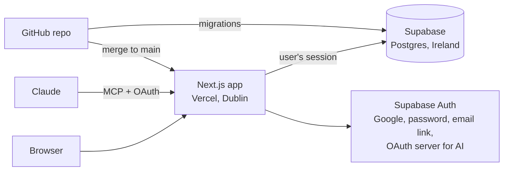
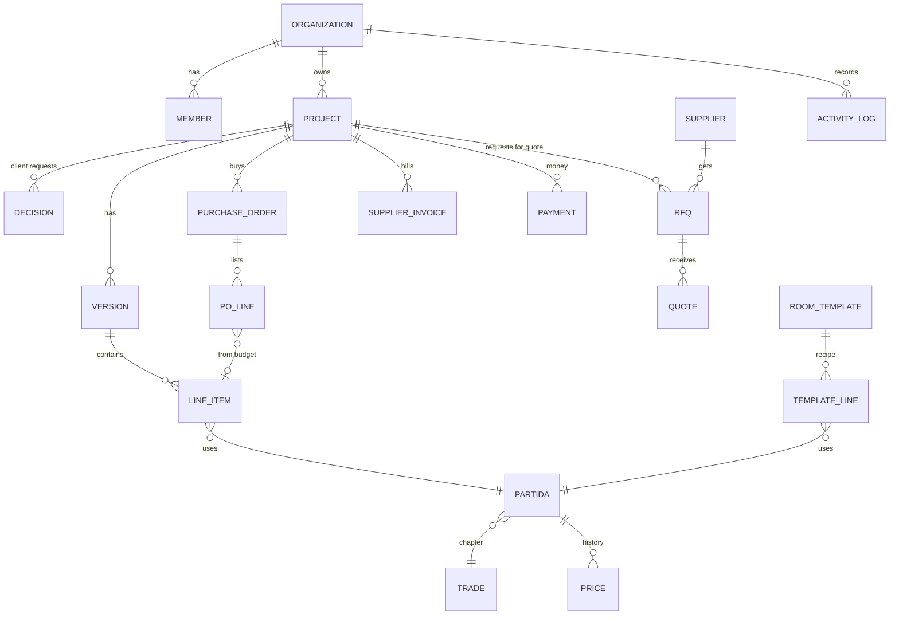
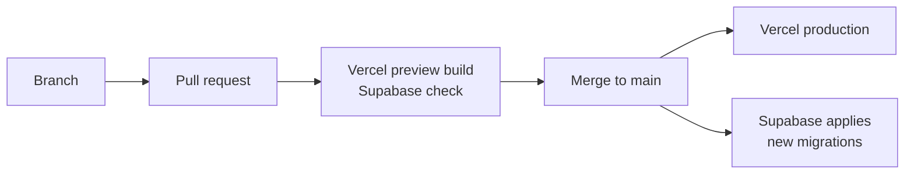

<!-- section: Technical -->
# Architecture
> How the platform is built: stack, data model, security, deployment and testing.

## Stack

| Part | Technology | Notes |
|---|---|---|
| Web app | Next.js 16 (App Router, server actions), React 19, Tailwind CSS 4 | Deployed on Vercel (region dub1) |
| Database | Supabase Postgres 17 (eu-west-1) | Row-level security on every table |
| Sign-in | Supabase Auth | Google (Internal), password, email link, plus an OAuth 2.1 server for AI assistants |
| AI | MCP server at `/api/mcp` | Stateless JSON-RPC, tools act as the signed-in user |
| Charts and diagrams | Recharts, Mermaid | |
| Exports | ExcelJS | xlsx and CSV generated on the server |

The app never holds a database master key: every query runs as the signed-in user, so the database decides what each person can see and do.

## Data model (main tables)

## Multi-tenancy and security

- Every studio's rows carry its organisation id. **Row-level security** lets each user see only their studio's rows, plus the shared catalogue for their region.
- **Composite foreign keys** stop a row from pointing at another studio's row, even by mistake.
- Shared catalogue rows (partidas, chapters, templates) have no organisation and are read-only. A studio's own version of a code overrides the shared one through `studio_partida()`.
- **Roles** live in the membership helpers every policy uses: viewers read, members write, admins manage the studio.
- **AI rules** are in the same helpers. A token issued to an assistant carries a `client_id`, and the database applies the studio's AI rules to it.
- **Activity log** triggers on every studio table, with `undo_change()` (see [Settings, roles and the activity log](/wiki/settings-and-roles)).

## Business rules in the database

| Rule | Where |
|---|---|
| One version until the project is won | Trigger on versions |
| A request for quote needs a named approver before *sent* | Check constraint |
| AI-read quote prices unused until reviewed | `current_prices()` |
| Unanswered requests expire | Daily pg_cron job |
| Studio partidas replace standard ones; hidden ones are skipped | `studio_partida()`, `apply_room_template()` |
| Line totals, invoice totals | Generated columns |

Rules sit in the database so they hold for the app, the AI assistant and any future integration alike.

## Deployment

- Database changes are **migrations** in `supabase/migrations`, applied automatically on merge to `main`. Their timestamps must be later than the last one applied.
- Every change goes through a pull request with a Vercel preview build.

## Testing

- `supabase/tests/run_local.sh` runs the migrations on a local Postgres and checks **102** rules: tenant isolation, the bid flow, catalogue and templates, the activity log and undo, roles, purchasing and AI rules.
- Type check, lint and production build before every merge. Screens are checked with screenshots in light and dark mode.

## Repository map

| Path | Contents |
|---|---|
| `app/` | Pages and server actions (dashboard, projects, budgets, purchases, catalogue, wiki, settings, AI endpoint) |
| `lib/` | Data access, MCP tools, exports, catalogue rules, formatting |
| `components/` | Shared UI: dialogs, charts, export menu, theme toggle |
| `app/theme.css` | Every colour, radius and font, each colour with its light and dark value |
| `supabase/migrations/` | Database schema, rules, seed catalogue |
| `supabase/tests/` | Database tests |
| `catalogue/` | Source of the Spain catalogue (Python) and its Excel export |
| `content/wiki/` | These pages, in Markdown |
