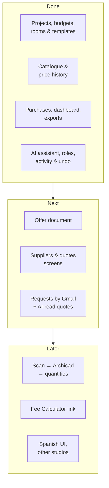

<!-- section: Technical -->
# Roadmap and ideas
> What's built, what's next, and the ideas behind it.

## Where things stand

## Next

1. **Offer document.** Turn a budget into the client offer: range or fixed price, contingency and VAT, exclusions, validity, payment schedule, PDF. The database already has offers with revisions.
2. **Suppliers and quotes screens.** Today these are reachable through the AI assistant only.
3. **Requests for quote by email.** Send approved requests from Gmail, chase automatically after 3 days (at most twice), and pick replies up from the thread.
4. **AI reading of quotes.** Turn a supplier's PDF into draft prices for review.

## Later

- **From scan to quantities.** Scan with Polycam/RoomPlan, model in Archicad, and read zones and elements through **Tapir** so quantities come from the model instead of templates. Partidas already carry an Archicad classification and filter for this mapping.
- **Fee Calculator link.** The design fee from Enzyme's Fee Calculator feeds into the offer. The two apps stay separate products that talk to each other.
- **Spanish interface.** The language setting is already stored. Offers and partidas are in Spanish already.
- **Other studios.** The platform is multi-tenant from day one. Other studios would bring their own prices and studio partidas on top of the shared catalogue.
- **Better ranges from evidence.** Tune the confidence spreads from actual vs estimated costs on finished jobs (see [Pricing and ranges](/wiki/pricing-and-ranges)).

## Open questions

| Question | Why it matters |
|---|---|
| Fixed price or range in the offer? | A range is honest. Clients often want one number. Maybe quote the top of the range with an itemised allowance |
| How much of the scan-to-Archicad step can be automated? | It's the biggest time saver, and the hardest |
| Should the shared catalogue learn from all studios' prices (anonymised)? | Better reference prices for everyone, but needs consent and care |
