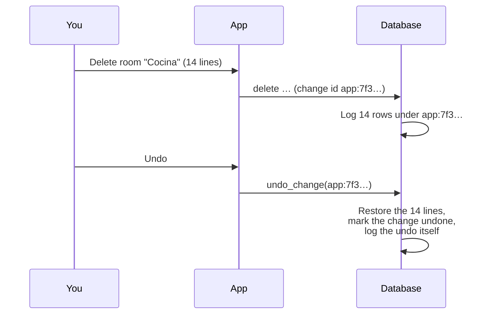

<!-- section: Working with the platform -->
# Settings, roles and the activity log
> Profile, studio settings, team roles and permissions, AI access, and undoing changes.

## Settings tabs

| Tab | What's there |
|---|---|
| **Profile** | Your name, language, password (optional, for signing in without email) |
| **Studio** | Name, currency, language of offers, default contingency (7%) and VAT (10%), default room height (2.60 m; a project can set its own), and whether options are allowed during the bid (off by default) |
| **Team** | Members and their roles, invitations by link |
| **AI access** | Assistant address, who may connect, who may let it change things, your connected apps, recent AI changes |
| **Activity** | Every change in the studio, with undo |

## Roles

| Can… | Owner | Admin | Member | Viewer |
|---|:---:|:---:|:---:|:---:|
| See everything in the studio | ✓ | ✓ | ✓ | ✓ |
| Create and edit projects, budgets, catalogue, purchases | ✓ | ✓ | ✓ | |
| Undo own changes | ✓ | ✓ | ✓ | |
| Undo anyone's changes | ✓ | ✓ | | |
| Change studio settings and AI rules | ✓ | ✓ | | |
| Invite people, change roles, remove members | ✓ | ✓ | | |
| Make or remove owners | ✓ | | | |

A studio always keeps at least one owner. Roles are enforced by the database, so the same rules apply in the app, the AI assistant and any future integration.

## The activity log

Every insert, change and delete on studio data is recorded automatically by the database: **who** (person or AI assistant), **when**, **what** (the row before and after) and **from where** (app, AI, automatic job). One action in the app is one **change**, even if it touches many rows. A batch edit of 12 lines is one change.

**Undo is safe:** it refuses if any of those rows were edited after the change (*"edited since"*), so it never overwrites newer work. Deleted rows come back with everything that was deleted with them.
