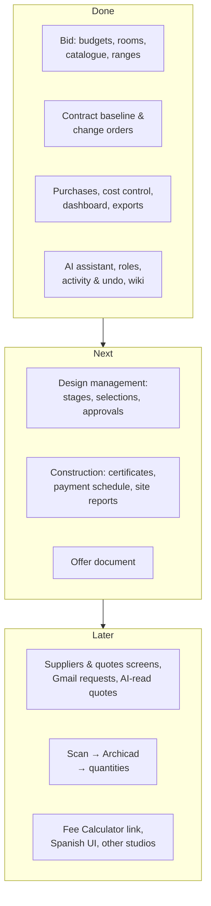

<!-- section: Technical -->
# Roadmap and ideas
> What's built, what's next across the project lifecycle, and the ideas behind it.

## Where things stand

## Next, by phase

### Design management
- **Design stages** (anteproyecto, proyecto básico, proyecto de ejecución) with deliverables, dates and client sign-off.
- **Client selections**: the finishes schedule (tiles, sanitaryware, taps, flooring, paint), with options, prices against the standard spec, and the client's choice. A selection that costs more than the standard becomes a change order automatically.
- **Approvals log**: what the client approved, when and on which drawing or selection.
- **Permit route** (licencia / declaración responsable) and its status.

### Construction
- **Progress certificates** (*certificaciones*): percentage done per chapter each month, against the current budget, for the contractor and for the client.
- **Client payment schedule** by milestone, with what's invoiced and received.
- **Site visit reports** with photos, and the **snag list** at handover.
- **Schedule**: start, milestones, handover date.

### Bid
- **Offer document**: range or fixed price, contingency and VAT, exclusions, validity, payment schedule, PDF.

## Later

- **Suppliers and quotes screens**, requests sent from Gmail with automatic reminders, AI reading of supplier quotes.
- **From scan to quantities**: Polycam/RoomPlan, then Archicad, then **Tapir**, so quantities come from the model instead of templates.
- **Fee Calculator link**: design fees per stage from Enzyme's Fee Calculator, invoiced alongside the works.
- **Spanish interface**, and **other studios** on the same platform (multi-tenant from day one).
- **Better ranges from evidence**: tune confidence spreads from actual vs estimated costs on finished jobs.

## Open questions

| Question | Why it matters |
|---|---|
| Should the platform be renamed now that it covers the whole lifecycle? | "Renovation Bids" describes only phase 1 |
| Fixed price or range in the offer? | A range is honest; clients often want one number |
| Who manages construction cost: the studio or the contractor? | Decides whether certificates are the studio's or the contractor's |
| Should the shared catalogue learn from all studios' prices (anonymised)? | Better reference prices for everyone, but needs consent |
